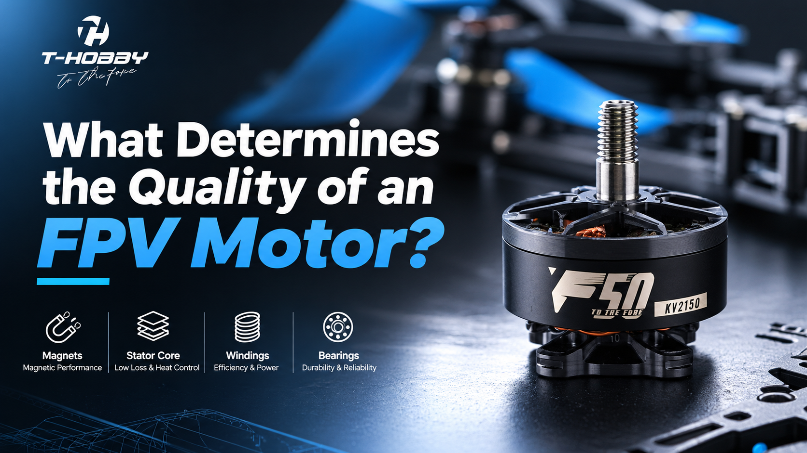

# What Determines the Quality of an FPV Motor?

An overview of the key factors that determine FPV motor quality, including magnets, stator core, windings, bearings, and manufacturing quality.

## Read the Full Article

[Read the full article](./article.md)
