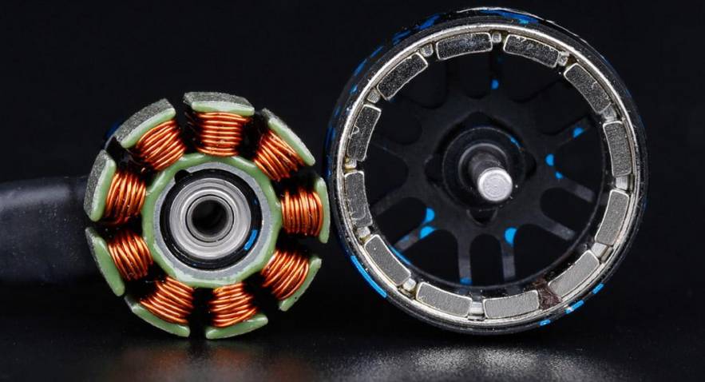
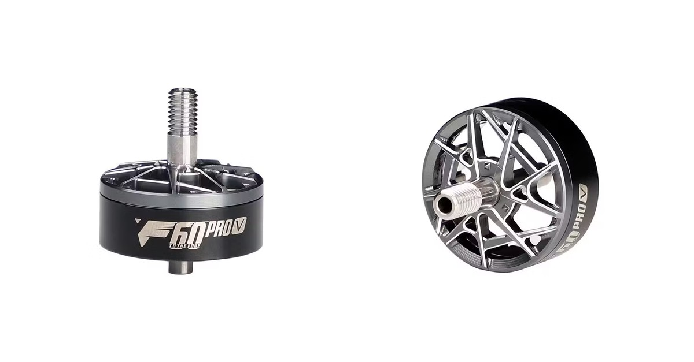
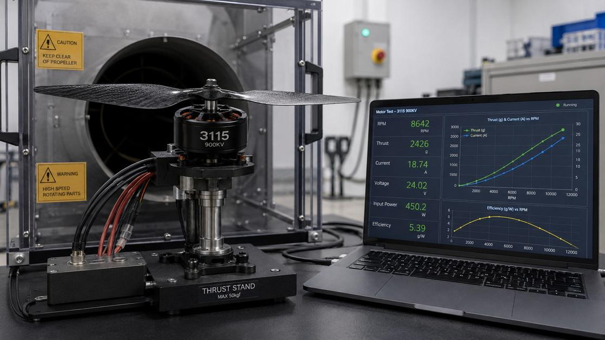

# What Determines the Quality of an FPV Motor?
 magnets are widely used in high-performance brushless motors because of their high magnetic energy density. However, magnet quality cannot be judged by magnetic strength alone. Remanence, coercivity, temperature characteristics, dimensional accuracy, and consistency all matter.

Temperature resistance is an important consideration for FPV motors, which can experience significant heating during aggressive flying or sustained high loads. NdFeB magnets are available in different grades, commonly identified by designations such as N, H, SH, UH, and EH. These grades indicate different magnetic and temperature-related characteristics. Actual operating limits depend on the specific magnet grade, its geometry, the magnetic circuit, and the motor’s operating conditions.

If a magnet is exposed to excessive temperatures or unfavorable magnetic fields, it may suffer irreversible demagnetization. This can reduce motor torque and efficiency and may increase current draw under certain operating conditions. Choosing an appropriate magnet grade and managing motor temperature are therefore essential to long-term reliability.

Intrinsic coercivity measures a magnet’s resistance to demagnetization. Higher coercivity can improve resistance to demagnetization, particularly at elevated temperatures, although the optimal balance depends on the motor design. Some high-temperature magnet grades use heavy rare-earth elements such as dysprosium or terbium to improve coercivity. These materials can increase manufacturing costs, making magnet selection a balance between performance, temperature requirements, and cost.

Arc-shaped magnets are common in brushless motors, while other geometries and segmented arrangements may be used to achieve specific magnetic characteristics. Precise dimensions and consistent positioning help maintain a uniform air gap between the rotor magnets and stator. Magnet shape and placement also influence the air-gap flux distribution, cogging torque, and magnetic losses.

The best design is not necessarily the one with the most complex magnet geometry, but the one optimized for the motor’s intended operating conditions.

## 2. Stator Core: Controlling Magnetic Losses and Heat

The stator core provides the magnetic path through which the motor operates. Its material properties and construction affect electromagnetic performance, efficiency, and heat generation.

Non-oriented electrical steel is widely used in motor stators because it offers suitable magnetic properties in different directions within the sheet. Instead of using a solid metal core, motor stators are typically assembled from thin electrical-steel laminations. Insulating layers separate adjacent sheets and restrict the flow of eddy currents.

Thinner laminations can reduce eddy-current losses, particularly under conditions involving rapidly changing magnetic fields. Lamination thickness must nevertheless be selected according to the motor’s operating frequency, manufacturing requirements, and overall design. Some high-performance motor designs use laminations around 0.15–0.20 mm thick, but these values are examples rather than universal standards for FPV motors.

Core loss consists mainly of hysteresis loss and eddy-current loss. These losses convert part of the electrical energy into heat rather than useful mechanical output. Electrical steel is available in different grades with varying magnetic properties and core-loss characteristics. Silicon content, sheet thickness, processing methods, and magnetic flux density all influence performance.

Low-loss electrical steel can improve efficiency and reduce heat generation, but material selection must also account for mechanical strength, manufacturability, and cost.

Each lamination typically has a thin insulating coating that helps prevent electrical contact between adjacent sheets. If the insulation is damaged or ineffective, interlaminar currents can increase, contributing to additional losses and heating. The coating must provide adequate electrical insulation and thermal stability without unnecessarily reducing the stator’s stacking factor—the proportion of the stack occupied by steel rather than insulation and other gaps.

Precise stamping, clean lamination edges, and consistent stacking are also important for maintaining the intended magnetic and mechanical properties of the stator.

## 3. Windings: Electrical Resistance, Power Delivery, and Heat

The stator windings carry current and generate the magnetic field that interacts with the rotor magnets. Their material, dimensions, insulation, and winding arrangement directly influence motor performance.

Copper is widely used in high-performance motor windings because of its high electrical conductivity. Winding resistance is a particularly useful indicator when evaluating motor performance. For a given current, resistive losses increase with resistance according to:

$$
P = I^2R
$$

Lower winding resistance can therefore reduce copper losses and heat generation under comparable operating conditions. However, resistance alone does not determine overall motor quality. The number of turns, wire cross-sectional area, winding arrangement, magnetic design, and operating conditions all affect the final result.

Copper has higher electrical conductivity than aluminum, making conductor material an important consideration in motor design. Copper-clad aluminum (CCA) combines an aluminum core with a copper outer layer. Although it can offer weight or cost advantages in certain applications, its electrical and thermal performance differs from that of solid copper conductors.

At high operating frequencies, AC resistance can also differ from DC resistance because of skin and proximity effects. Their significance depends on frequency, conductor dimensions, and winding geometry. For high-performance FPV motors, conductor material should therefore be evaluated alongside measured winding resistance, thermal performance, weight, and current-handling capability—not treated as an isolated quality indicator.

Even when two motors use similar copper wire, differences in winding execution can affect their performance. Consistent turn placement, secure winding, appropriate insulation, and reliable electrical connections help maintain predictable resistance and reduce the risk of short circuits.

Winding fill factor—the proportion of the available winding space occupied by conductor—also matters. A well-designed winding arrangement makes effective use of the available space while maintaining adequate insulation and manufacturability.

Motor winding wire is coated with insulating enamel that prevents electrical contact between adjacent turns. Different insulation systems have different thermal classes and mechanical properties. Some are designed for high-temperature applications, but the actual rating must be verified against the wire manufacturer’s specifications.

Reliable insulation is essential because excessive heat, abrasion, or manufacturing damage can compromise the winding and lead to electrical failure.

## 4. Bearings: Smooth Rotation and Mechanical Reliability

**T-HOBBY F60 PROV Motor Bearing**

Bearings support the motor shaft and allow the rotor to rotate with minimal friction. Their performance influences smoothness, noise, vibration, and service life.

Chrome steel is commonly used for bearing races and rolling elements in small electric motors. Some high-performance applications use hybrid ceramic bearings, which typically combine steel races with silicon-nitride ceramic balls. Ceramic balls are lighter than steel balls and provide electrical insulation. Their lower mass can be advantageous in certain high-speed applications, while their electrical insulation can help reduce the risk of current-related bearing damage in suitable systems.

However, hybrid ceramic bearings are not automatically superior in every application. Actual performance depends on bearing geometry, clearances, lubrication, loads, speed, and installation quality.

Bearing precision grades such as ABEC-5 and ABEC-7 specify dimensional and geometric tolerances. These classifications are useful, but they do not independently determine overall bearing quality. Raceway finish, internal clearance, material quality, lubrication, and suitability for the intended operating conditions also matter.

For an FPV motor, a bearing must be selected and installed to support the required rotational speed and mechanical loads while maintaining acceptable friction and vibration.

Lubrication reduces friction and wear between rolling elements and raceways. The lubricant must be suitable for the expected speed, temperature, and load. Dust and debris can also affect bearing performance, particularly when flying in sandy, dusty, or outdoor environments.

Depending on the application, bearings may use shields or seals to limit contamination. These features involve trade-offs: protection can improve contamination resistance, while certain sealing arrangements may increase friction. The objective is to achieve the right balance between rotational performance, contamination protection, and durability.

## 5. Rotor, Shaft, Housing, and Assembly

A motor’s structural components maintain alignment, support mechanical loads, and keep the rotating assembly stable. Their design becomes increasingly important as rotational speed rises.

Motor shafts are commonly made from hardened steel or other suitable materials selected for strength, wear resistance, and manufacturing requirements. Shaft diameter, geometry, heat treatment, and alignment influence rigidity and resistance to bending. These factors are particularly relevant to FPV motors, which may experience sudden loads during aggressive maneuvers or impacts.

Hollow shafts can reduce weight in suitable designs, but their benefits depend on the geometry and the resulting balance between mass and structural strength.

The motor base and rotor bell must provide adequate structural strength while keeping weight under control. Aluminum alloys are commonly used for motor housings and rotor components because of their relatively low density and useful mechanical properties. Different alloys offer different combinations of strength, machinability, and thermal conductivity.

For example, 7075 aluminum alloy offers high strength, while other aluminum alloys may be selected for different manufacturing or thermal requirements. The most appropriate material depends on the component’s function and design.

CNC machining can provide precise dimensions and controlled geometries. Other manufacturing methods can also be suitable when they meet the required tolerances and performance specifications. Material selection and manufacturing quality should be evaluated together rather than assuming that a particular alloy or process guarantees a better motor.

The rotor must be balanced to limit vibration during rotation. Poor balance can increase bearing loads, create unwanted vibration, and affect the overall flying experience. Manufacturers may use controlled material removal, balancing compounds, or other corrective features to achieve the desired balance.

The accuracy of the balancing process and the reliability of any corrective features are important, especially for motors operating at high rotational speeds. Good dynamic balancing helps the motor run smoothly, but vibration can also originate from bearing quality, shaft alignment, propeller imbalance, mounting, or other components in the assembled drone.

Motor mounting screws and propeller fasteners must be appropriate for the intended loads, thread engagement, and installation geometry. High-strength fasteners may be used in certain applications, but screw grade, size, and installation torque should be selected according to the design rather than assumed to be identical across all motors.

Suitable thread-locking compounds can help prevent loosening under vibration when used correctly. Compatibility with the materials and assembly process is important, and excess compound should be kept away from bearings and other sensitive components.

The connections between the motor windings and external motor leads must withstand electrical current, heat, and mechanical movement. Wire insulation, soldering quality, strain relief, and protection against abrasion all contribute to reliability. High-temperature insulation materials, including PTFE-based options, may be suitable depending on the application.

A strong winding design can still fail if the external leads or solder joints are poorly executed. Electrical connections are therefore an important part of overall motor quality.

## 6. Real-World Performance: Efficiency, Thrust, and Temperature

Material specifications explain part of a motor’s potential, but actual performance must be evaluated under operating conditions relevant to the intended application.

For FPV motors, three factors are particularly important:

**Thrust and efficiency:** Thrust describes the force produced by the motor-and-propeller combination. Efficiency describes how effectively electrical input power is converted into useful output. A motor that draws more current does not necessarily produce proportionally more thrust. Performance depends on the motor design, propeller, battery voltage, ESC settings, and operating point.

Thrust and current measurements taken under controlled conditions can help compare different motors and identify suitable motor–propeller combinations.

**Thermal performance:** Motor temperature depends on winding losses, magnetic and core losses, mechanical losses, airflow, propeller load, and operating duration. Excessive temperature can accelerate insulation aging, affect lubrication, and increase the risk of permanent magnet demagnetization.

Thermal performance should therefore be assessed under clearly defined test conditions, including voltage, propeller, throttle or load, test duration, and cooling environment.

*Images are for reference only. Please refer to the actual product.*

**Response and consistency:** FPV flying often involves rapid throttle changes and frequent transitions between acceleration and deceleration. Motor behavior depends on torque characteristics, rotor inertia, electrical design, and ESC control. A motor that performs well in one setup may behave differently with another propeller or battery configuration.

Consistency between individual motors is also important. Significant differences in resistance, balance, or mechanical quality can affect the behavior of a quadcopter, even when the motors share the same model designation.

## 7. Manufacturing Quality Control: Turning Good Materials into a Good Motor

High-quality materials are only part of the equation. Manufacturing and quality control determine whether those materials consistently deliver the intended performance.

Important checks may include:

- **Dimensional inspection:** Verifying shaft, bearing-seat, stator, and rotor dimensions.
- **Winding inspection:** Checking electrical continuity, resistance, insulation, and phase consistency.
- **Rotor balancing:** Measuring and correcting imbalance to control vibration.
- **Assembly inspection:** Checking bearing installation, shaft alignment, fasteners, and structural clearances.
- **Performance testing:** Evaluating current draw, RPM, thrust, efficiency, and temperature under defined conditions.
- **Batch consistency:** Confirming that motors from the same production run deliver comparable results.
Not every motor requires the same testing procedure. The appropriate quality-control process depends on the product’s intended application, performance targets, and manufacturing requirements.

What matters is that quality claims are supported by appropriate specifications, repeatable tests, and consistent production standards.

## Conclusion: Motor Quality Is the Result of Every Detail Working Together

The quality of an FPV motor cannot be determined by one material, one specification, or one manufacturing technique.

Magnets influence magnetic performance and resistance to demagnetization. Stator laminations affect magnetic losses. Windings influence electrical resistance and heat generation. Bearings support smooth rotation, while the shaft, rotor, housing, and assembly determine mechanical stability and reliability.

Just as importantly, the final motor must deliver the expected performance under real operating conditions. Efficiency, thrust, temperature, vibration, and manufacturing consistency all help reveal how well its design works as a complete system.

For FPV pilots, the goal is not simply to choose a motor with the most impressive specifications. It is to choose a motor whose design, manufacturing quality, and performance match the demands of the build.

A good FPV motor is more than the sum of its components. It is a carefully engineered system in which every detail contributes to reliable power, predictable response, and consistent performance in the air.
